# claude-puppet-overlay

Claude puppets that float over your Mac desktop, like the old Office paperclip, and act out what Claude Code is doing: one puppet per busy Claude session.

| When Claude is... | The puppet... |
| --- | --- |
| reading your prompt | rests its chin on its paw, with a thought bubble |
| working | types on its laptop and shoots an invader on its monitor with every tool call, or watches green Matrix rain pour faster with each one; now and then it turns to smile at you |
| reading or searching files | moves a magnifying glass over the monitor |
| running tests | shows a progress bar, then a green ✓ or a red ✗ |
| running subagents | plays ping pong: two puppets, one per subagent, each named after its task and scoring its own tool calls |
| asking you something or showing a plan | raises its hand: "I have a question for you", "Plan ready for you" |
| waiting for a permission | holds up a sign with the tool's name: "May I use Bash?" |
| done | says the first sentence of Claude's answer, like "Fixed the parser and added two tests. ✓" |
| between turns | rests at its desk with the monitor off, and dozes off after a while |

## What it looks like

| | |
| --- | --- |
| 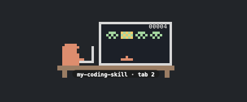 | **Coding.** It types on its laptop and shoots an invader on its monitor with every tool call. The tag says which command it runs and in which tab. |
| 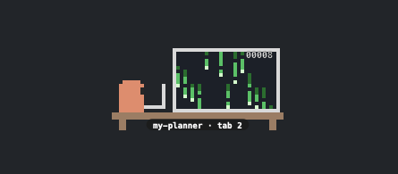 | **Matrix.** The same desk with green code rain, which pours faster with each tool call. |
| 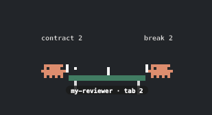 | **Ping pong.** One puppet per subagent, each scoring its own tool calls. |
| 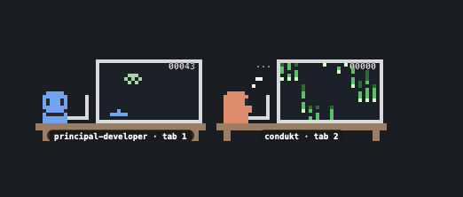 | **Thinking and smiling.** Right: reading your prompt, with a thought bubble. Left: now and then a working puppet turns to smile at you. |
| 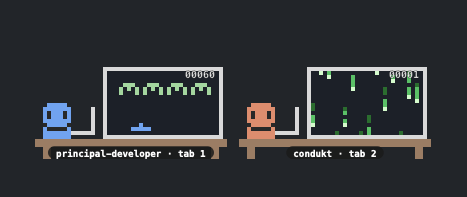 | **Happy.** The smile, on two puppets at once. |
| 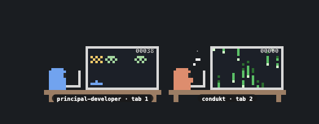 | **Coder and Matrix side by side.** One tab codes while the other has just been given a prompt. |
| 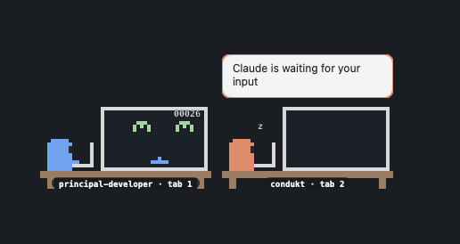 | **Waiting for you.** Claude's own notifications show in the bubble of the session they come from. |
| 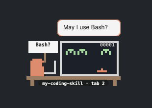 | **Waiting for a permission.** It holds up the tool's name and asks. |
| 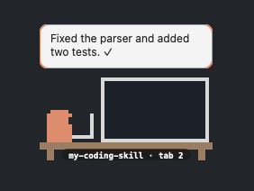 | **Done.** The bubble says the first sentence of Claude's answer. |
| 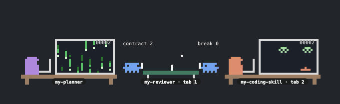 | **Several sessions.** One puppet per busy session, each in its own colour and scene. |
| 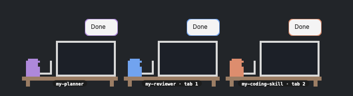 | **All done.** Each session says so above its own puppet. |
| 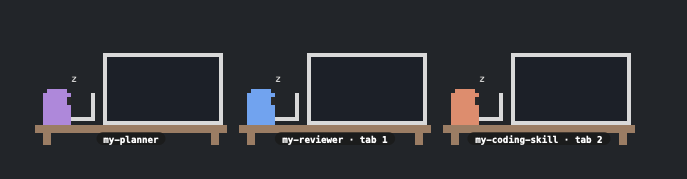 | **Between turns.** Each puppet rests at its desk, monitor off, and dozes off. |
| 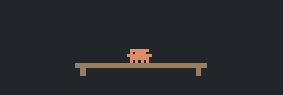 | **Nothing running.** One puppet waits at home. |

- **One puppet per session:** with one tab coding and another reviewing, two puppets sit side by side, each in its own colour, with a name tag (the command you ran, or the project folder), its own scene and its own bubble. Between turns a puppet rests at its desk with the monitor off, and dozes; it leaves when its session ends or its iTerm tab closes. With no session on stage, one puppet waits at home.
- **Choose what plays** from the `▟▙` menu bar icon (or Option-click a puppet): list `my-coding-skill` under Coder, `my-planner` under Matrix and `my-reviewer` under Ping pong, and set the main conversation to Coder, Matrix, auto or Off. Each tab's puppet follows the command that tab runs.
- **See where each one is:** under the name tag, a short line gives the project folder and how long the puppet has been at it (`my-app · 32m`, `idle 12m`, `waiting 3m`). Rest the mouse on a puppet for a card with the rest: the session's title (as Claude Code names it), its folder and tab, the command and what it is doing, its subagents (by their task while working, and how many are done), its tool calls and the last tool, and the first sentence of its last reply.
- **Click a puppet** (or its bubble) to jump to the terminal running that session. In iTerm2 it selects the exact window and tab, and the tab number is written under the puppet's table (`tab 3`, or `window 2 · tab 3` with several windows).
- **Drag any puppet** to move the whole row, across screens too; it stays on top of every app and every desktop. The `▟▙` menu bar icon sends the row to the corner of any screen, and puppets left on a screen you unplug come back to the main one.

It is two small pieces: a hook that writes one line per agent event to `~/.claude-puppet/events`, and a [Hammerspoon](https://www.hammerspoon.org) Spoon that reads them and draws the puppets. Claude Code is the first agent it supports; each agent is a separate *harness*, so Codex, Cursor, OpenCode and others can be added (see [Contributing](CONTRIBUTING.md)). Nothing leaves your machine. From your prompts it keeps only a leading `/command`; from Claude's answers, only the first sentence; otherwise the tool names, the project folder's name and the terminal tab; never commands or code.

## Install

**[INSTALL.md](INSTALL.md)** walks through it in about 5 minutes, on macOS 13 or later with Homebrew. What it changes on your Mac:

- installs Hammerspoon, a free macOS automation app (Homebrew);
- adds `~/.claude-puppet/` (the source and the events file) and links `~/.hammerspoon/Spoons/ClaudePuppet.spoon` to it;
- adds two lines to `~/.hammerspoon/init.lua`;
- adds the puppet's hook to `~/.claude/settings.json`, after saving a backup, keeping your other settings and hooks;
- asks you to allow Hammerspoon in **Accessibility** (to drag and click the puppets) and, with iTerm2, **Automation** (to show and select each session's tab), and to start it at login.

INSTALL.md also covers [choosing what plays](INSTALL.md#choose-what-plays), [updating](INSTALL.md#update) and [uninstalling](INSTALL.md#uninstall).

## Contributing

New agents, animations and fixes are welcome: [CONTRIBUTING.md](CONTRIBUTING.md) explains the layout, how to run the tests, and how to add an agent or an animation. The design is in [docs/architecture.md](docs/architecture.md).

## More

Pairs with the in-terminal mods [puppet-ping-pong](https://github.com/cassiodias/claude-ping-pong) and [puppet-coder](https://github.com/cassiodias/claude-coder), but needs neither.

## License

MIT
