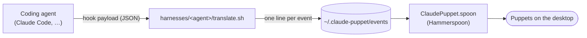
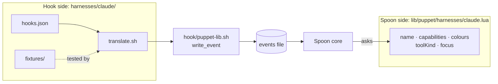
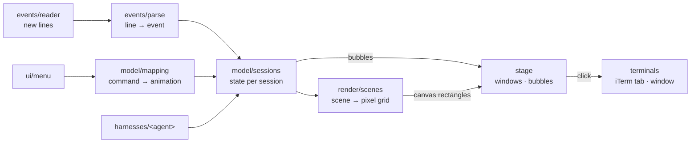

# Architecture

Puppets float over the desktop, one per busy coding-agent session, and act out what the agent is doing. Two
parts make that work: **hooks** in each agent write one line per event to a file, and a **Hammerspoon Spoon**
reads the file and draws the puppets.



## Harnesses: one per agent

Each coding agent is a **harness**, kept apart from everything else so it can be added, tested and fixed on its
own. A harness has two halves:



| Half | Where | What it does |
| --- | --- | --- |
| Hook side | `harnesses/<agent>/` | `hooks.json` registers `translate.sh` with the agent; `translate.sh` turns the agent's payload into one event line; `fixtures/` holds payload samples and the line each must produce |
| Spoon side | `ClaudePuppet.spoon/lib/puppet/harnesses/<agent>.lua` | tells the Spoon what it needs about the agent: its name, which events it can send, its colours, what its tools mean, and how to reach its window |

The Spoon side is a small table:

```lua
return {
  id = "claude",                   -- written on every event line
  name = "Claude",                 -- used in texts like "Claude needs you"
  capabilities = { prompt = true, tools = true, toolFailure = true, subagents = true,
                   permission = true, question = true, reply = true, sessionEnd = true },
  character = { palette = { "#D97757", "#5B8DEF" } },          -- puppet colours
  toolKind = function(tool) ... end,                           -- "reading", "question", "plan", "skill" or nil
  focus = function(session, terminals) ... end,                -- bring its window forward on a click
}
```

Rules:

- **The core never asks which agent it is.** It asks the session's harness (`toolKind`, `capabilities`, `focus`).
- **Common event names.** Translators use Claude Code's names (`UserPromptSubmit`, `PreToolUse`, `PostToolUse`,
  `PostToolUseFailure`, `PermissionRequest`, `SubagentStart`, `SubagentStop`, `Notification`, `Stop`,
  `SessionEnd`). An agent without an event simply never sends it, and that mood never shows.
- **One writer.** Only `write_event` in `hook/puppet-lib.sh` writes the events file.
- **Never block the agent.** A translator always exits 0 and prints whatever its agent needs in order to go on.

Claude Code is the only harness so far. Codex, Cursor, OpenCode and Antigravity have hook systems close enough
to add, each with gaps (for example, Cursor and Antigravity send no permission event); each one starts from
payloads captured on a real run.

## The event line

```
time|event|session|agent id|tool|agent type|text|folder|terminal app|flag|tty|harness
```

- `text` is a prompt's leading `/command`, a skill's name, a notification, or the first sentence of a reply.
  Nothing else from prompts or replies, and never commands or code.
- `flag` is `test` when a shell command runs tests.
- A line without the last field is read as `claude`.

The format lives in two places only: `hook/puppet-lib.sh` (writing) and `events/parse.lua` (reading). It stays a
pipe-separated line because translators are shell scripts; JSON would need `jq` and escaping in each of them.

## The Spoon

`ClaudePuppet.spoon/init.lua` holds the Spoon's public settings and wires the parts in `lib/puppet/`:

| Module | Job | Uses Hammerspoon |
| --- | --- | --- |
| `config.lua` | sizes, timings, colours | no |
| `events/parse.lua`, `events/reader.lua` | read new lines from the events file; replay recent history on start | no |
| `model/sessions.lua` | the state of each session, changed one event at a time; returns bubbles to show | no |
| `model/mapping.lua` | which animation each command shows, and what the main conversation shows | no |
| `harnesses/` | the Spoon side of each harness, and the registry | no |
| `render/` | pixels, sprites, text, and `scenes/`: one file per animation (`desk`, `monitor`, `invaders`, `matrix`, `pingpong`, `home`) | text styling only |
| `stage/` | the puppet windows, their layout and bubbles | yes |
| `terminals/` | bringing a session's terminal forward; iTerm tab numbers | yes |
| `ui/menu.lua` | the menu bar menu | yes |

Each frame, 10 times a second:



Sessions, mapping and drawing are plain Lua, so they run in the tests without Hammerspoon.

Two behaviours worth knowing:

- **A command keeps its animation while its work runs.** A message without a `/command`, sent while the turn or
  its subagents are still working, belongs to that work. Only a new `/command`, or a message once the session is
  idle, changes the animation.
- **Puppets survive restarts.** On start, the Spoon replays the last two hours of events, without bubbles.

## Tests

`tests/run.sh` runs everything; it needs Lua 5.4 (`brew install lua@5.4`).

| Test | Checks |
| --- | --- |
| `scenario_test.lua` | the whole Spoon through every scene, with a stand-in for Hammerspoon; every frame is compared with `tests/snapshots/scenario.txt` |
| `sessions_test.lua` | the session model, driven by a fake harness |
| `harness_contract_test.lua` | every harness has what the Spoon expects |
| `harnesses.sh` | every translator against its fixtures |

## Next

- Harnesses for Codex, then Cursor, OpenCode and Antigravity; with them, a different look per agent.
- A name that is not tied to Claude, once a second agent works.
- After a restart, a session whose iTerm tab was closed in the meantime comes back until it times out.
